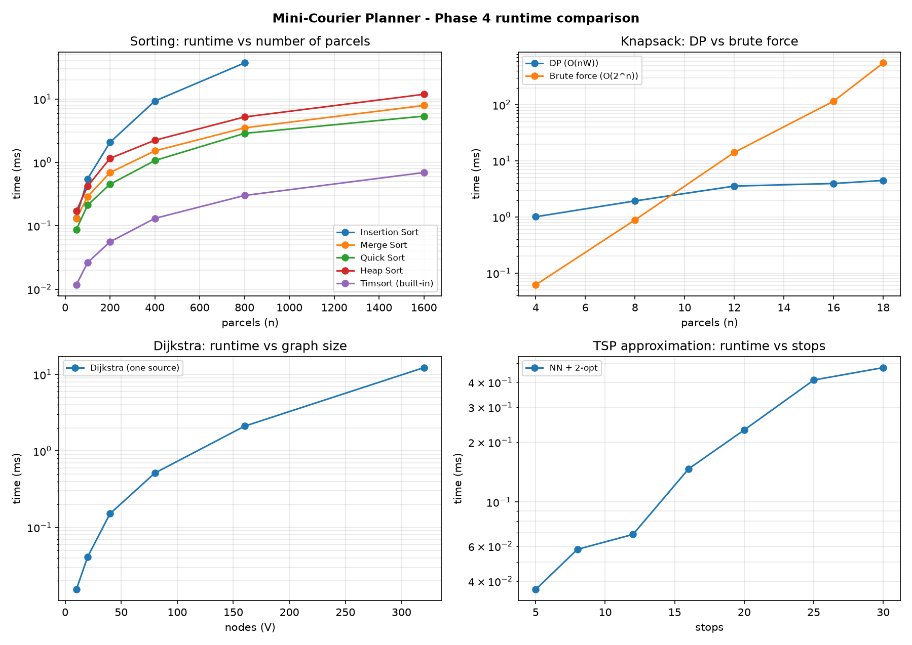
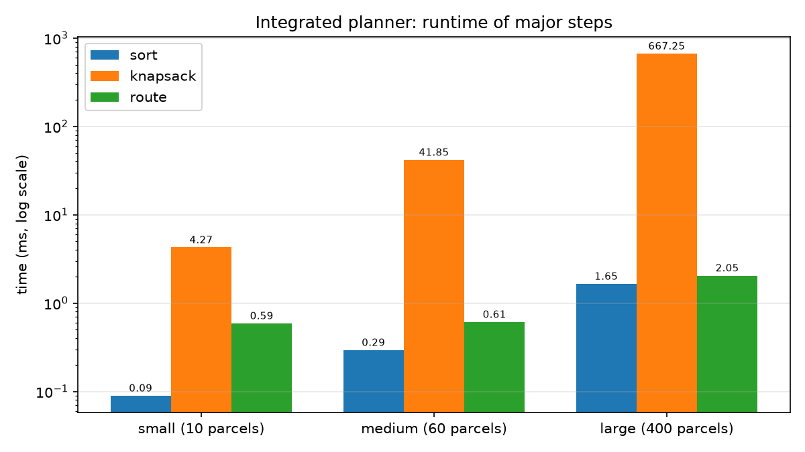

# Phase 5 - Final Report and Demonstration

**Mini-Courier Planner**
Capstone Assignment - Design & Analysis of Algorithms (ETCCDA302)
K.R. Mangalam University | B.Tech CSE | Faculty: Dr. Shweta Agarwal

Student: **Shourya Awasthi** | Roll No.: **2501350073**
Submission: source code + datasets + documentation + runtime charts + output traces

---

## Abstract

The Mini-Courier Planner is an integrated Python application that turns a list of
parcels into a complete one-trip delivery plan. It prioritises parcels with a stable
merge sort (earliest deadline first), chooses the most valuable feasible load with an
exact 0/1 knapsack dynamic program, packs the load into physical boxes with
first-fit decreasing, and routes the van with Dijkstra shortest paths plus a
nearest-neighbour TSP tour improved by 2-opt. Every component is benchmarked across
input sizes. On the 10-parcel sample the planner loads 6 parcels (19.5 of 20 kg,
value 2745) and shortens the greedy tour from 72.00 km to 63.06 km (12.4%). On 400
parcels the full plan takes 514 ms, 99.5% of which is the knapsack DP - the main
target for future optimisation.

---

## 1. Introduction and objectives

Courier companies must answer four questions for every trip: *which parcels go first,
which parcels fit, in what order should they be loaded, and which road order is
shortest?* Each question maps to a classical algorithm studied in the course:

| Question | Algorithm | Phase |
|---|---|---|
| Which parcels go first? | Comparison sorting (merge sort) | 2a |
| Which parcels fit and maximise value? | 0/1 knapsack dynamic programming | 2b |
| How are they packed physically? | First-fit decreasing bin packing | 2b |
| What is the shortest way between stops? | Dijkstra | 3 |
| What is a good overall tour? | Nearest-neighbour TSP + 2-opt | 3 |
| How does it scale? | Empirical runtime analysis | 4 |

**Objectives:** a correct, modular and commented Python implementation; reproducible
sample datasets; measurable correctness evidence; and a runtime comparison that
explains *why* one algorithm behaves differently from another.

---

## 2. Phase 1 - Design summary

The full design is in [`phase1_design.md`](phase1_design.md). Key decisions:

* **Data:** parcels (`id, destination, weight, priority, deadline, tier`) and a
  12-node city graph stored as CSV. Value is derived from priority, urgency and
  customer tier so the business rule lives in one place.
* **Pipeline:** sort → knapsack → boxes → Dijkstra distance matrix → NN tour → 2-opt.
* **Why merge sort:** stability (equal deadlines keep receipt order) and an
  O(n log n) worst-case guarantee. Quick sort's O(n²) worst case could delay an
  urgent parcel.
* **Why exact DP:** parcels are indivisible, so a greedy value/weight rule can be
  arbitrarily far from optimal; DP is exact and demonstrable.
* **Why a heuristic tour:** exact TSP is O(n²2ⁿ); a courier needs a route in
  milliseconds, and NN + 2-opt is typically within a few percent of optimal.

---

## 3. Phase 2 - Package prioritisation and box filling

### 3.1 Sorting (Phase 2a)

Production ordering uses **merge sort** with key
`(deadline_min, -priority, weight_kg)`. The small dataset after sorting:

| # | Parcel | Destination | Weight | Priority | Deadline | Tier | Value |
|---|---|---|---|---|---|---|---|
| 1 | PKG0007 | Old-City | 2.0 kg | 3 | 30 min | standard | 357 |
| 2 | PKG0001 | Hospital | 4.0 kg | 5 | 45 min | platinum | 635 |
| 3 | PKG0002 | Market | 2.5 kg | 4 | 60 min | gold | 504 |
| 4 | PKG0005 | Mall | 5.0 kg | 4 | 75 min | gold | 502 |
| 5 | PKG0003 | Station | 3.0 kg | 3 | 90 min | silver | 376 |
| 6 | PKG0004 | University | 1.5 kg | 2 | 120 min | standard | 248 |
| 7 | PKG0006 | Airport | 6.5 kg | 5 | 150 min | platinum | 625 |
| 8 | PKG0010 | Industrial | 7.0 kg | 3 | 180 min | gold | 392 |
| 9 | PKG0008 | School | 3.5 kg | 2 | 210 min | silver | 264 |
| 10 | PKG0009 | Tower-A | 4.5 kg | 1 | 300 min | standard | 130 |

Five comparison sorts are implemented (`insertion`, `merge`, `quick`, `heap`,
`timsort`) and all five are checked against Python's `sorted()` on 120 random parcels.

### 3.2 Knapsack DP (Phase 2b)

`dp[i][w]` = best value using the first `i` parcels with `w` capacity. Capacity is
converted to 10 g integer units so the table is exact. Excerpt of the DP table
(capacity 12 kg, columns every 1 kg) produced by `python main.py dp-table --capacity 12`:

```
items considered    w(kg)    v |     0     1     2     3     4     5     6     7     8     9    10    11    12
(none)                  -    - |     0     0     0     0     0     0     0     0     0     0     0     0     0
PKG0007               2.0  357 |     0     0   357   357   357   357   357   357   357   357   357   357   357
PKG0001               4.0  635 |     0     0   357   357   635   635   992   992   992   992   992   992   992
PKG0002               2.5  504 |     0     0   357   504   635   861   992  1139  1139  1496  1496  1496  1496
PKG0005               5.0  502 |     0     0   357   504   635   861   992  1139  1139  1496  1496  1641
PKG0003               3.0  376 |     0     0   357   504   635   861   992  1139  1237  1496  1515  1515  1872
...
Optimal value at capacity 12 kg = 1872
```

Every cell is `max(previous row, parcel value + cell at capacity − weight)`. The DP is
verified against exhaustive enumeration on three random instances
(n = 10, 14, 16) and matches exactly.

### 3.3 Selected load and packing plan (20 kg van, small dataset)

* **Selected:** PKG0007, PKG0001, PKG0002, PKG0003, PKG0004, PKG0006
* **Total weight:** 19.50 kg / 20 kg  |  **Total value:** 2745
* **Skipped:** PKG0005, PKG0010, PKG0008, PKG0009

| Box | Load | Parcels |
|---|---|---|
| 1 | 6.50 kg | PKG0006 *(oversized parcel - needs a large box)* |
| 2 | 4.00 kg | PKG0001 |
| 3 | 5.00 kg | PKG0003, PKG0007 |
| 4 | 4.00 kg | PKG0002, PKG0004 |

The DP prefers four smaller high-value parcels over the 7 kg / value 392 parcel,
which is the expected behaviour of an exact knapsack.

Evidence: `docs/screenshots/01_demo_small.txt`, `02_dp_table.txt`.

---

## 4. Phase 3 - Route maker and graph processing

### 4.1 Graph representation

The city is an undirected weighted graph stored as an adjacency list
(`dict[node] -> [(neighbour, km)]`). Twelve nodes come from
`data/delivery_points.csv`; edge weight = Euclidean distance × 1.25 road factor.
The structure supports sparse graphs, so real road data can replace the complete
graph without changing any algorithm.

### 4.2 Dijkstra shortest paths from the depot (small trip)

| Stop | Distance | Path |
|---|---|---|
| Hospital | 7.53 km | Depot → Hospital |
| Old-City | 8.22 km | Depot → Old-City |
| Station | 10.25 km | Depot → Station |
| Market | 10.40 km | Depot → Market |
| University | 10.62 km | Depot → University |
| Airport | 15.47 km | Depot → Airport |

Dijkstra is also validated against a hand-computed six-node graph
(`Depot→B→A→C→D = 10 km`) and returns exactly that path.

### 4.3 Final route (nearest neighbour + 2-opt)

```
Depot -> Station -> Airport -> University -> Market -> Hospital -> Old-City -> Depot
```

| Leg | km |
|---|---|
| Depot → Station | 10.25 |
| Station → Airport | 5.38 |
| Airport → University | 6.37 |
| University → Market | 14.25 |
| Market → Hospital | 11.86 |
| Hospital → Old-City | 6.73 |
| Old-City → Depot | 8.22 |
| **Total** | **63.06** |

* Nearest-neighbour tour: **72.00 km**
* After 2-opt: **63.06 km**
* Improvement: **12.4%** (8.94 km saved on one trip)

The tour visits every selected destination exactly once and returns to the depot, so
it is a valid closed tour. 2-opt never returns a longer route than its input
(checked in `verify.py`).

Medium dataset: 10 stops, 73.01 km (from 75.28 km, 3.0% better).
Large dataset: all 11 customer nodes, 81.79 km (from 84.06 km, 2.7% better).

---

## 5. Phase 4 - Performance testing and optimisation

### 5.1 Test setup

* Python 3.13, Windows, single thread; each timing is the **best of 3** runs
  (`time.perf_counter`) to reduce OS noise.
* Random parcels/graphs use fixed seeds; datasets are in `data/`.
* Full raw data: [`runtime_results.csv`](runtime_results.csv).
* Charts: [`runtime_comparison.png`](../charts/runtime_comparison.png),
  [`phase_breakdown.png`](../charts/phase_breakdown.png).

### 5.2 Sorting: five algorithms

Runtime in ms (n = number of parcels):

| n | Insertion | Merge | Quick | Heap | Timsort |
|---|---|---|---|---|---|
| 50 | 0.158 | 0.131 | 0.087 | 0.172 | 0.012 |
| 100 | 0.562 | 0.293 | 0.211 | 0.402 | 0.025 |
| 200 | 2.454 | 0.702 | 0.488 | 0.974 | 0.057 |
| 400 | 9.453 | 1.561 | 1.122 | 2.336 | 0.131 |
| 800 | 41.832 | 4.601 | 2.337 | 5.262 | 0.528 |
| 1600 | - | 8.534 | 5.234 | 12.152 | 0.687 |

**Analysis.** Doubling n from 400 to 800 multiplies insertion-sort time by 4.4×,
confirming Θ(n²). Merge sort grows 2.9×, quick sort 2.1× and heap sort 2.3×, matching
Θ(n log n). Timsort wins by a constant factor (optimised C implementation, run
detection) but is in the same asymptotic class as merge sort. Insertion sort is only
competitive for tiny or nearly sorted inputs - which is exactly why it is not used
for 400 parcels.

### 5.3 Knapsack: DP vs brute force

| n | DP (O(nW)) | Brute force (O(2ⁿ)) | Speed-up |
|---|---|---|---|
| 4 | 1.23 ms | 0.07 ms | brute force wins |
| 8 | 1.98 ms | 0.87 ms | brute force wins |
| 12 | 2.97 ms | 14.72 ms | 5× |
| 16 | 3.90 ms | 121.46 ms | 31× |
| 18 | 5.04 ms | 603.16 ms | **120×** |

**Analysis.** Brute force doubles with every extra parcel (2ⁿ); DP grows linearly with
n for fixed capacity. The crossover is around n = 10. At n = 20 brute force would need
about 1.2 s, at n = 25 about 40 s, while DP stays under 6 ms. This is the classic
pseudo-polynomial trade-off: DP depends on `n·W`, not on `2ⁿ`.

### 5.4 Dijkstra and TSP scaling

| Nodes | Dijkstra (ms) | | Stops | NN + 2-opt (ms) |
|---|---|---|---|---|
| 10 | 0.015 | | 5 | 0.020 |
| 20 | 0.044 | | 8 | 0.033 |
| 40 | 0.140 | | 12 | 0.063 |
| 80 | 0.756 | | 16 | 0.153 |
| 160 | 2.130 | | 20 | 0.225 |
| 320 | 13.345 | | 25 | 0.682 |
| | | | 30 | 0.491 |

**Analysis.** Dijkstra on a complete graph scans O(V²) edges per run, giving the
observed slightly super-linear curve. The TSP heuristic is effectively flat in this
range (sub-millisecond): 2-opt is O(n²) per pass but the number of passes falls as
tours become locally optimal, and at 25-30 stops measurement noise dominates (the
25-stop run happened to need more passes than the 30-stop run).

### 5.5 Integrated planner

| Dataset | Parcels | Selected | Stops | Sort (ms) | Knapsack (ms) | Route (ms) | Total (ms) | Route km | Value |
|---|---|---|---|---|---|---|---|---|---|
| Small | 10 | 6 | 7 | 0.033 | 2.727 | 0.409 | **3.19** | 63.06 | 2745 |
| Medium | 60 | 20 | 10 | 0.172 | 39.792 | 0.819 | **40.81** | 73.01 | 8260 |
| Large | 400 | 61 | 12 | 1.785 | 511.110 | 0.671 | **513.60** | 81.79 | 25227 |

**Analysis.** The knapsack dominates: 85.5% of the small plan, 97.5% of medium and
99.5% of large. Going from 60 to 400 parcels (6.7×) increases knapsack time 12.8×
because the van capacity also doubled (40 → 80 kg), so `n·W` grows 13.3× - the
measured growth matches the predicted O(n·W) almost exactly. Sorting grows 10.4× for
6.7× more parcels, consistent with O(n log n). Routing time stays below 1 ms because
the number of *distinct destinations* is bounded by the 11 customer nodes, not by the
number of parcels.





### 5.6 Optimisation suggestions

1. **Scale the DP capacity.** 10 g units give W = 8000 at 80 kg. Using 100 g or 1 kg
   buckets cuts the table by 10-100× with negligible loss of packing precision - the
   single biggest win.
2. **Space-optimised DP with divide-and-conquer reconstruction.** The 1-D variant
   already computes the optimal value in O(W) memory; Hirschberg-style reconstruction
   removes the O(nW) table.
3. **Branch-and-bound for very large n.** Sort by value density, use the fractional
   knapsack as an upper bound, and prune - often explores a tiny fraction of the tree.
4. **Use Timsort in production.** It is 7-12× faster than the pure-Python merge sort
   at these sizes and remains stable, so EDF ordering is preserved.
5. **Precompute the distance matrix once per depot** and cache it between plans;
   routing is already cheap, but this removes repeated Dijkstra runs.
6. **Exact TSP for small trips.** Held-Karp is O(n²2ⁿ), practical up to ~15 stops, and
   would replace the heuristic gap with an optimal tour for dense city centres.
7. **Parallelise or vectorise Dijkstra** per source with NumPy/SciPy (`scipy.sparse.csgraph`)
   if the graph grows to thousands of nodes.

---

## 6. Phase 5 - Results, demonstration and conclusion

### 6.1 What was achieved

* A modular Python system (≈ 1,250 lines including comments) implementing sorting,
  dynamic programming, graph shortest paths, TSP approximation and bin packing.
* Reproducible datasets at three scales and a CLI that runs any of them.
* **15/15 correctness checks** and **11 unit tests** pass, including DP-vs-brute-force
  and all-sorts-vs-`sorted()` comparisons.
* Runtime charts and a raw CSV that quantify every major step.
* A one-command demo that prints the sorted parcels, the chosen load, the box plan,
  Dijkstra distances, the route with per-leg distances and step timings.

### 6.2 Demonstration script (5 minutes)

```bash
python main.py demo                 # 1. full plan on the small dataset
python main.py dp-table             # 2. walk through the DP table
python main.py demo --data data/parcels_large.csv --capacity 80   # 3. scale up
python main.py verify               # 4. correctness evidence
python main.py benchmark            # 5. regenerate charts + CSV
```

Then open `charts/runtime_comparison.png` and explain the four curves.

### 6.3 Viva quick answers

| Question | Answer |
|---|---|
| Why merge sort and not quick sort? | Stable (equal deadlines keep receipt order) and O(n log n) worst case; a bad pivot must never delay urgent parcels. |
| Why not a greedy knapsack? | Parcels are indivisible; greedy value/weight can be far from optimal. DP is exact. |
| What does `dp[i][w]` mean? | Best value using the first i parcels with capacity w. |
| Why convert capacity to integers? | DP indices must be integers; 10 g units keep precision and exactness. |
| Why does the DP dominate runtime? | Its cost is O(n·W) with W = capacity in 10 g units (8000 at 80 kg), while sorting is O(n log n) and routing has ≤ 12 stops. |
| Why does 2-opt help? | It removes crossing edges: reversing a segment replaces two long edges with two shorter ones. |
| Is the tour optimal? | No - it is a heuristic. It is valid, never worse than nearest neighbour, and typically within a few percent of optimal. |
| How would you handle multiple vans? | Solve a vehicle-routing problem: assign parcels to vans (bin packing / DP per van), then route each van with the same pipeline. |
| What if a parcel is heavier than a box? | It is still selected if it fits the van, and flagged as an oversized parcel in the packing plan. |
| How do you know the DP is correct? | It matches exhaustive enumeration on n = 10, 14, 16 and the 1-D variant matches the 2-D table. |

### 6.4 Limitations

* One van, one trip, weight-only capacity (no volume or time windows).
* Complete-graph distances with a road factor rather than real road data.
* DP is pseudo-polynomial; capacity scaling is needed for very large vans.
* NN + 2-opt has no optimality guarantee (usually 2-5% above optimal).
* Deadlines influence value and ordering but are not simulated as hard time windows.

### 6.5 Future work

Multi-trip / multi-van VRP, real road graphs with traffic, time-window penalties,
Held-Karp for small tours, a Streamlit dashboard, and a REST API so a dispatcher can
submit parcels from a phone.

### 6.6 Conclusion

The prototype meets all five phases: it designs a coherent courier problem, prioritises
parcels with a stable sort, selects the optimal load with DP, packs boxes, computes
shortest paths and a short delivery tour, and explains its own performance with
measured data. The most important engineering insight is that the exact knapsack is
both the correctness centrepiece and the runtime bottleneck - which is precisely the
kind of trade-off this capstone asks students to identify and evaluate.

---

## Appendix A - How to run

```bash
python -m pip install -r requirements.txt
python main.py demo
python main.py dp-table --capacity 12
python main.py verify
python main.py benchmark
python -m unittest discover -s tests -v
```

## Appendix B - Evidence index

| Evidence | File |
|---|---|
| Small-trip plan | `docs/screenshots/01_demo_small.txt` |
| DP table | `docs/screenshots/02_dp_table.txt` |
| Medium-trip plan | `docs/screenshots/03_demo_medium.txt` |
| Large-trip plan | `docs/screenshots/04_demo_large.txt` |
| Benchmark console output | `docs/screenshots/05_benchmark_output.txt` |
| Correctness checks (15/15) | `docs/screenshots/06_verification.txt` |
| Raw runtime numbers | `docs/runtime_results.csv` |
| Runtime charts | `charts/runtime_comparison.png`, `charts/phase_breakdown.png` |
| Design document | `docs/phase1_design.md` |
| Source code | `courier/`, `main.py`, `tests/` |
